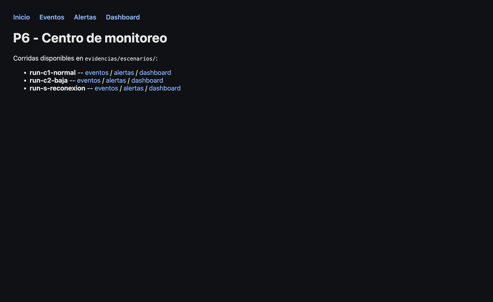
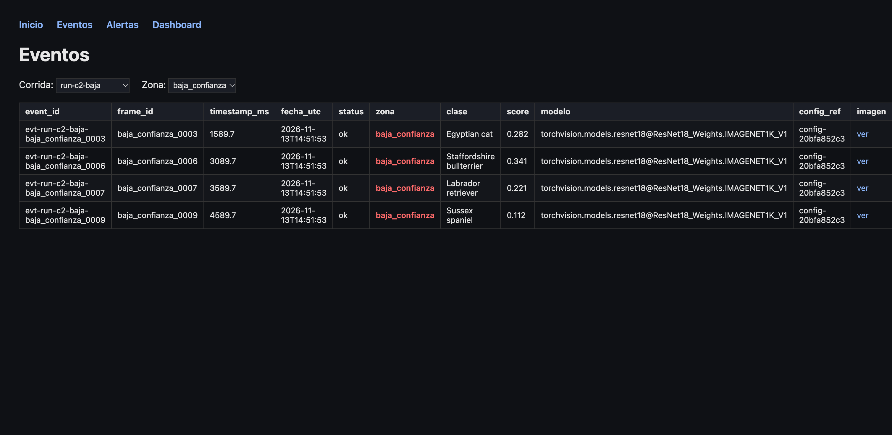
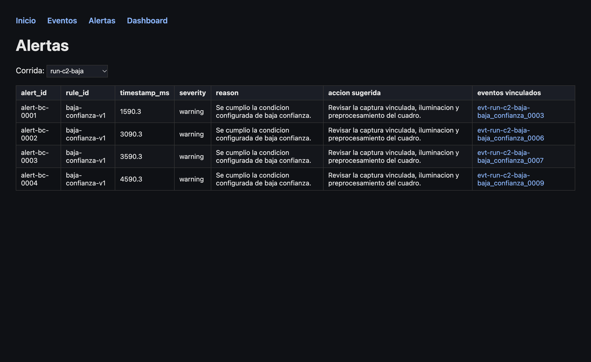
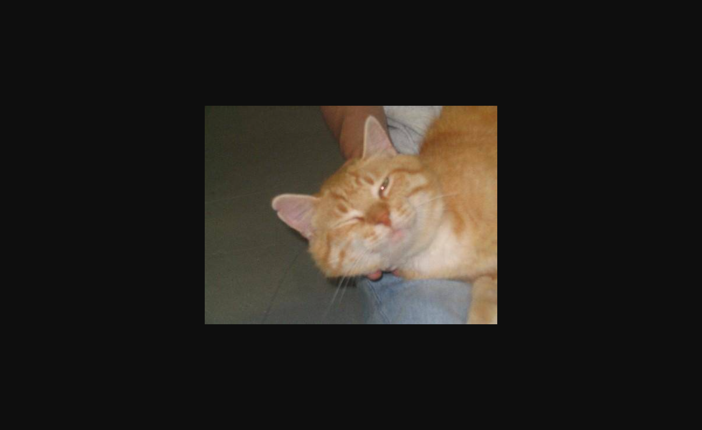
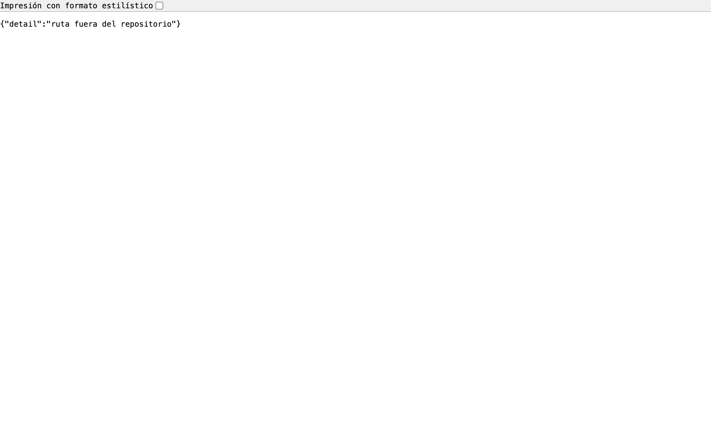
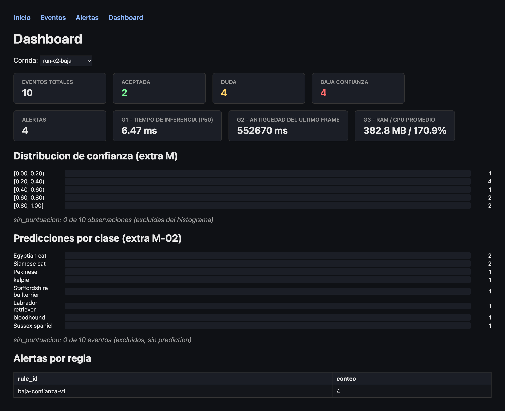
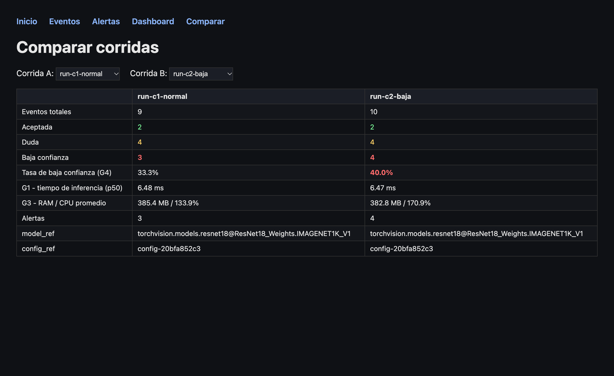

# Recorrido del portal (R4.2, R5.3)

Recorrido reproducible -- cada paso es un comando o una URL real, no una
narracion. Requiere tener al menos una corrida (ver README, "Correr los
escenarios"); este recorrido asume que ya corriste C1 y C2.

## 1. Levantar el portal

```bash
PYTHONPATH=src P6_EVIDENCIAS_DIR=evidencias/escenarios uvicorn p6.portal.app:app --reload
```

## 2. Inicio -- `GET /`

Lista solo las corridas reales (las que tienen `eventos-<run_id>.db`, nunca
las carpetas de documentacion `normal/`/`baja-confianza/`), cada una con
enlaces directos a sus eventos, alertas y dashboard.



## 3. Eventos -- `GET /eventos?run_id=run-c2-baja`

Tabla de los 10 eventos de C2, cada fila con `event_id`, `frame_id`,
`timestamp_ms`, `status`, zona de confianza (coloreada), clase predicha, score
e imagen (si se capturo). Filtrar por zona:
`GET /eventos?run_id=run-c2-baja&zona=baja_confianza` reduce la tabla a los 4
eventos en esa zona.



## 4. Alertas -- `GET /alertas?run_id=run-c2-baja`

Tabla de las 4 alertas `baja-confianza-v1` de C2, cada una con `rule_id`,
`timestamp_ms`, `severity`, `reason`, `accion sugerida`, y un enlace
`event_id -> /imagenes?ruta=...` a la captura real que origino la alerta.



## 5. Imagen vinculada -- `GET /imagenes?ruta=evidencias/escenarios/run-c2-baja/imagenes/evt-run-c2-baja-baja_confianza_0003.jpg`

Clic en cualquier `event_id` de la tabla de alertas sirve el archivo real
(`FileResponse`), validado contra la raiz del repositorio (una ruta fuera del
repo responde 403) y contra una lista de extensiones de imagen validas (una
ruta real del repo pero que no es imagen, ej. `README.md`, tambien responde
403 -- antes del fix cualquier archivo del repo se serviria); una ruta
inexistente responde 404. Ver
`tests/test_portal.py::test_imagenes_rechaza_ruta_fuera_del_repositorio`,
`test_imagenes_rechaza_archivo_que_no_es_imagen` y `test_imagenes_404_si_no_existe`.



`GET /imagenes?ruta=../../../etc/passwd` (una ruta fuera del repositorio)
responde 403, no el archivo:



## 6. Dashboard (extra F-01) -- `GET /dashboard?run_id=run-c2-baja`

Vista agregada: conteo de eventos por zona, G1 (tiempo de inferencia p50), G2
(antiguedad real del ultimo frame), G3 (uso de recursos), el histograma de
confianza (extra M-01), la distribucion de predicciones por clase (extra
M-02) y alertas por regla. Cambiar la corrida con el selector reconsulta
todo en vivo.



## 7. Comparar corridas (extra F-02) -- `GET /comparar?run_a=run-c1-normal&run_b=run-c2-baja`

Contrasta dos corridas lado a lado: eventos por zona, tasa de baja confianza
(G4, resaltada la mayor), G1, G3, alertas, y la identidad de modelo/config de
cada una. Si `model_ref` o `config_ref` no coinciden entre las dos, muestra
un aviso explicito en vez de comparar a ciegas series que no deberian
compararse (la guia pide mantener esa identidad al comparar, o separar las
series si cambian).



## Estados verificados (no solo el camino feliz)

- `GET /` sin ninguna corrida: `evidencias/escenarios/` vacio -> mensaje
  explicito, no un error 500
  (`tests/test_portal.py::test_sin_corridas_las_vistas_no_fallan`).
- `GET /dashboard?run_id=<corrida-sin-eventos>`: mensaje explicito, no falla
  (`test_dashboard_corrida_sin_eventos_no_falla`).
- `GET /dashboard?run_id=<corrida-sin-mediciones.jsonl>`: G1/G3 muestran
  "sin datos" en vez de un error
  (`test_dashboard_sin_mediciones_reporta_sin_datos_en_g1_g3`).
- `GET /comparar` sin corridas, o con una corrida sin eventos: mensaje
  explicito, no falla (`test_comparar_sin_corridas_no_falla`,
  `test_comparar_corrida_sin_eventos_no_falla`).
- `GET /comparar` con dos corridas de `model_ref` distinto: aviso explicito de
  identidad, probado forzando el caso, no solo observado
  (`test_comparar_avisa_si_la_identidad_no_coincide`).

Las 19 pruebas de `tests/test_portal.py` cubren cada ruta descrita arriba con
`fastapi.testclient.TestClient` sobre datos reales (nunca mockeados): son la
evidencia "observado/reproducido" de este recorrido, ejecutable con
`pytest tests/test_portal.py -q`.
